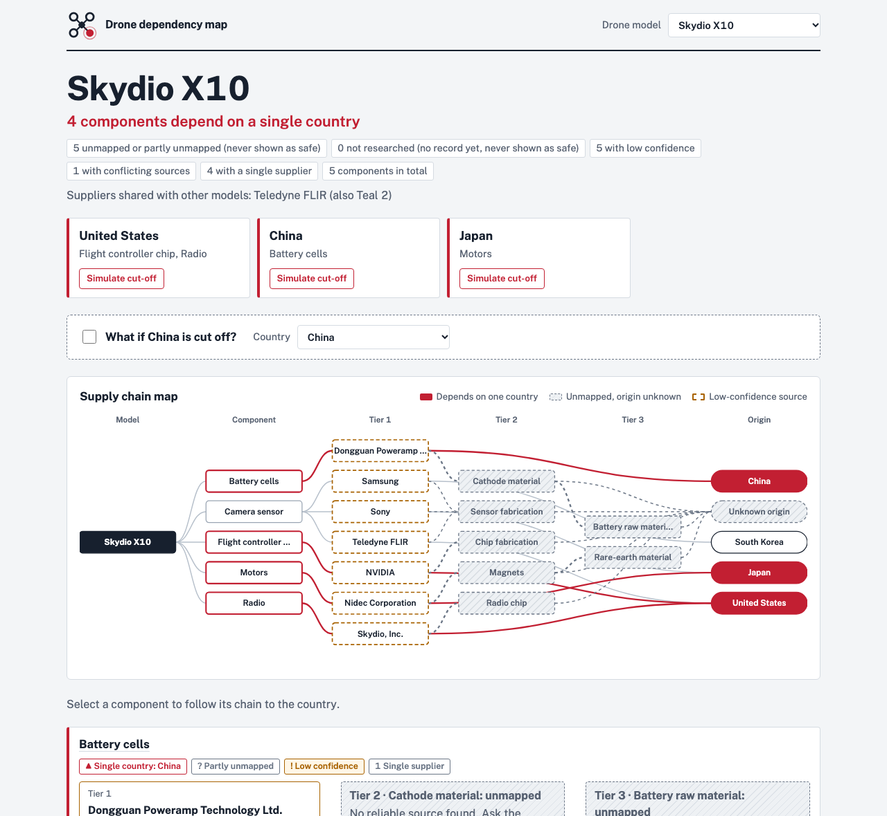
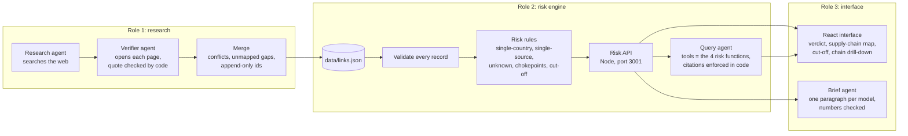
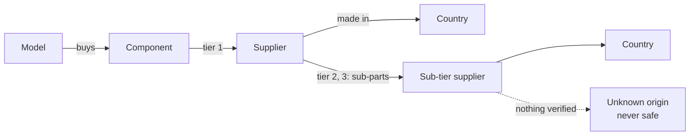

# Drone dependency map


**See where a drone depends on a single country, before an export control or a disruption shows you.**

Procurement officers can see a drone's first-tier suppliers, but not what sits underneath: the magnets in the motors, the cells in the battery, the fab behind the chip. That sub-tier detail is scattered across teardowns, filings and news, and mapping one model by hand takes weeks. This project uses AI research agents to build a sourced supplier map, a risk engine to flag single-country dependencies, and an interface that shows the whole chain on one screen, with a source link behind every claim.



## What the map shows today

Four models, 56 supplier records. Every mapped link was checked by a verifier agent, and 2 more were rejected by hand. These figures come from `data/links.json` as of this commit, read through the risk engine:

| Model | Components that depend on a single country | Partly or fully unmapped |
|---|---|---|
| Skydio X10 | battery cells (China), flight controller chip (US), motors (Japan), radio (US) | 5 of 5 |
| Parrot Anafi USA | flight controller chip (US), radio (Canada) | 5 of 5 |
| Teal 2 | camera sensor (US), motors (US), radio (Singapore) | 5 of 5 |
| DJI Mavic 3 Enterprise | radio (China) | 4 of 5 |

What that means:

- **A China cut-off provably hits 2 components** (Skydio X10 battery cells, DJI Mavic 3 Enterprise radio), and **18 more cannot be ruled out** because a tier is unmapped. The tool shows those as unknown, never as safe.
- **Teledyne FLIR is a shared supplier**: the same thermal sensor maker sits in Skydio X10 and Teal 2.
- **Public sources answer "who does the drone maker buy from", not "what is inside the part".** 20 of 56 links are mapped, none at high confidence, and almost every sub-tier (magnets, cell materials, chip fabs) is unmapped. The [riskiest-bet test](research/riskiest-bet.md) failed on sub-tier for this reason. Sub-tier data needs paid teardowns, customs records or vendor questionnaires; the interface says "Ask the vendor" on every gap.

Per-model detail and the research notes behind every gap: [research/coverage.md](research/coverage.md).

## How it works



Every supplier claim is a record that links one **component** of one **model** to one **supplier** in one **country** at one **tier**, with the **source** behind it:



The rules, the record format and a worked example are in [docs/risk-model.md](docs/risk-model.md). The design decisions behind them are in [docs/architecture.md](docs/architecture.md).

## Quick start

**You need:** Node 22 or newer, and an OpenCode API key for the two AI features (the question box and risk briefs). Python 3 is needed only to run the research pipeline (tested on 3.14).

```bash
npm install
```

```bash
(cd web && npm install && npm run build)
```

```bash
cp .env.example .env
```

Fill in `OPENCODE_API_KEY` in `.env`, then start the server:

```bash
npm start
```

Open http://localhost:3001. The map, cut-off and drill-down work without a key; only the question box and briefs need it.

### Configuration (`.env`)

| Variable | Used by | Needed for |
|---|---|---|
| `OPENCODE_API_KEY` | API server, research pipeline, brief agent | The question box, risk briefs, and running the pipeline |
| `ANTHROPIC_BASE_URL` | API server | Where Claude requests go. `.env.example` sets OpenCode's Anthropic-compatible endpoint |
| `ANTHROPIC_API_KEY` | API server | Optional: a separate key for the question box. Leave empty to reuse `OPENCODE_API_KEY` |
| `TAVILY_API_KEY`, `JINA_API_KEY` | Research pipeline | Optional: better search and page fetching. Without them it falls back to free search and plain HTTP |
| `PORT` | API server | Optional: defaults to 3001 |

The server loads `.env` itself and lets it win over the shell, because some shells (Claude Code among them) already set `ANTHROPIC_BASE_URL`.

## Everyday commands

| What | Command |
|---|---|
| Run the app | `npm start`, then open http://localhost:3001 |
| Work on the interface with live reload | `npm start` here, `npm run dev` in `web/`, then open http://localhost:5173 |
| Risk engine and API tests | `npm test` |
| Interface unit tests, type check | `cd web && npm test && npm run typecheck` |
| Browser tests | `cd web && npm run test:e2e` |
| Research more models | `python -m pipeline.run --models "Model name" --budget 2` ([details](pipeline/README.md)) |
| Draft risk briefs | `cd web && npm run briefs` (server running, key set) |
| Full check after a data drop | `cd web && npm run data-drop` |

## Repository layout

| Path | What lives there | Owner |
|---|---|---|
| `data/links.json` | Every supplier record. Append-only: a record's position is its id | Role 1 |
| `pipeline/` | Research, verifier and merge steps that build `links.json` ([README](pipeline/README.md)) | Role 1 |
| `research/` | Coverage note, riskiest-bet result, hand-check overrides, and `raw/`: the full audit trail of every agent run | Role 1 |
| `src/risk.js` | Validation and risk rules: pure functions over `links.json` | Role 2 |
| `src/agent.js` | The query agent behind `ask()` | Role 2 |
| `src/server.js` | The Risk API, plus the built interface, on one port | Role 2 |
| `test/` | Risk engine and agent tests, on fake data in `test/fixtures/` | Role 2 |
| `web/` | The interface: Vite, React, TypeScript, built to `web/dist/` ([notes](docs/interface.md)) | Role 3 |
| `web/tests/`, `web/scripts/` | Browser tests, the brief agent and the data-drop check | Role 3 |
| `docs/` | Brief, architecture, API, risk model, interface, demo script, user test | All |

## The team

| Role | Owns | Agentic part |
|---|---|---|
| 1. Research engineer | The dataset and its quality | Research agents per model and component, a verifier agent, a merge step |
| 2. Platform engineer | The graph, risk rules and API | The query agent: answers only by calling the API, and code enforces its citations |
| 3. Product engineer | The interface, user test and demo | A browser-test run on every data drop (`data-drop`), and a risk-brief agent |

## Documentation

| Doc | For |
|---|---|
| [docs/brief.md](docs/brief.md) | The product brief: problem, success metric, riskiest bet |
| [docs/architecture.md](docs/architecture.md) | How the pieces fit, the four agents, where trust is enforced, and why |
| [docs/risk-model.md](docs/risk-model.md) | The data model, the record format and every risk rule |
| [docs/api.md](docs/api.md) | Every endpoint, with real responses |
| [docs/interface.md](docs/interface.md) | What each screen state means, interface checks, risk briefs |
| [docs/links-format.md](docs/links-format.md) | How Role 1's pipeline writes `links.json` |
| [docs/demo-script.md](docs/demo-script.md) | A five-minute demo |
| [docs/user-test.md](docs/user-test.md), [results](docs/user-test-results.md) | The user test protocol and results |

## Known limits

- **Sub-tier data is mostly missing**, as above. The map is honest about it but cannot fill it from public sources.
- **No link is high confidence.** No public page says where a part is made, so most countries are the supplier's headquarters.
- **Some sources are stale.** Skydio's battery supplier is a former supplier; see the hand-written gaps in [research/coverage.md](research/coverage.md).
- **The 1-hour target is not measured yet.** The user test is written but not run, and the 2 to 3 weeks manual baseline is unverified.
- **Risk briefs are snapshots.** Regenerate them after every data drop.

## Troubleshooting

| You see | Do this |
|---|---|
| `{"error":"not found"}` at http://localhost:3001 | The interface isn't built. Run `cd web && npm install && npm run build` |
| The question box says it is not set up (503) | Set `OPENCODE_API_KEY` in `.env` and restart. If the key is set, check that your OpenCode workspace has `claude-haiku-5-5` enabled: a disabled model also shows as 503 |
| An error naming `links.json rejected: record N …` | A record breaks the format. The message names each bad record and why; fix them in `data/links.json` |
| Browser tests fail with "Executable doesn't exist" | Run `cd web && npx playwright install chromium-headless-shell` |
| "No brief has been drafted for this model yet" | Run `cd web && npm run briefs` with the server running and the key set |
| The page font looks plain | Public Sans loads from Google Fonts. Offline, the page falls back to the system font and works the same |
