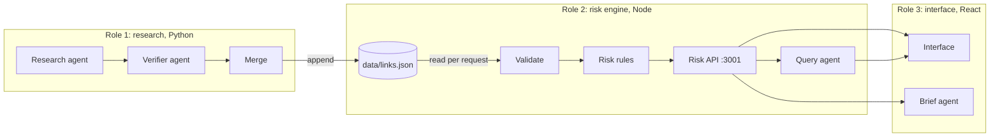

# Architecture

Three roles, one data file, one server. Research agents write `data/links.json`; the risk engine reads it and serves verdicts; the interface and two more agents read the verdicts. Nothing downstream computes risk on its own.



## Data flow

1. **Research** (`pipeline/`). For each model and research category (motors, magnets, battery cells, flight controller chip, camera sensor, radio), a research agent searches the web and returns up to 3 sourced candidates per part and tier.
2. **Verify.** A verifier agent opens every source page and rates each claim `high`, `low` or `unmapped`. Code then checks that the verifier's evidence quote really appears on the page. Claims based only on a supplier's headquarters are capped at `low`. If every source for a tier is rejected, research runs once more with those URLs excluded.
3. **Hand check.** `research/overrides.json` holds verdicts a person made after reading the evidence; they override the verifier (2 so far).
4. **Merge.** Rejected links are dropped, supplier spellings folded into one, conflicts flagged, and an `unmapped` record written for every tier searched with no result. New records are appended; existing ones keep their position, which is their id. The full trail of every job goes to `research/raw/`.
5. **Validate and assess** (`src/risk.js`). On every API request the server re-reads `links.json`, validates every record, and runs the [risk rules](risk-model.md).
6. **Serve** (`src/server.js`). The [Risk API](api.md) answers the interface, the query agent and the brief agent, and serves the built interface on the same port.
7. **Show** (`web/`). The interface renders the verdict, the supply-chain map, the cut-off scenario and each chain with its sources. It computes no risk itself.

## The agents

| Agent | Where | Model | Tools | What keeps it honest |
|---|---|---|---|---|
| **Research** | `pipeline/research.py` | `deepseek-v4.1-flash`, falling back to `glm-5.3-flash`, then `claude-sonnet-5-5`, through OpenCode | Web search (Tavily, falling back to `ddgs`), page fetch (Jina Reader, falling back to plain HTTP) | Must return a source URL for every claim |
| **Verifier** | `pipeline/verify.py` | Same chain | Opens the source page | Code checks its quoted evidence is on the page; HQ-only claims capped at `low` |
| **Query** | `src/agent.js` | `claude-haiku-5-5` at effort `low`, through OpenCode | Only the four risk functions | Code drops any citation it did not see in a tool result; no valid citation means the fixed refusal |
| **Brief** | `web/scripts/draft-briefs.ts` | `claude-haiku-5-5`, through OpenCode | Reads the Risk API | Every number must come from the API; every unmapped component must be named; a draft failing twice is not written |

### The query agent

`ask(question)` runs a tool loop of at most 10 turns. The agent may call `get_models`, `get_model_risk`, `get_chain` and `simulate_cutoff`, and must finish with structured output: `{ answer, cited_link_ids }`.

```
question
  └─ loop (max 10 turns)
       ├─ agent calls a risk function ──▶ result goes back to the agent
       │                                  every link id in the result is recorded as "seen"
       └─ agent answers { answer, cited_link_ids }
            ├─ keep only ids that were seen
            ├─ none left ──▶ "No mapped data to answer that."
            └─ otherwise ──▶ { answer, links: [the full records] }
```

Its `get_models` tool returns each model with one of its record ids (the public endpoint returns plain names), so "which models exist?" can be answered with a citation. Its instructions say that unmapped is never safe, that magnets are tier 2 of motors, and that it must use no outside knowledge. The citation check is what enforces the last one: an answer from general knowledge has nothing it is allowed to cite.

## Where trust is enforced

| Risk | Check | Where |
|---|---|---|
| A research agent invents a supplier | A second agent opens the page; code confirms the quote is on it | `pipeline/verify.py` |
| A wrong but plausible source | Hand-check overrides | `research/overrides.json` |
| A malformed record makes a component look safe | The whole file is rejected, naming every bad record | `parseLinks` in `src/risk.js` |
| A gap reads as "no risk" | `unknown` is a reason of its own, and cut-offs list unknowns separately | `src/risk.js` |
| The query agent answers from general knowledge | Citations must come from tool results seen in that conversation | `src/agent.js` |
| A brief misstates the numbers | Every number and unmapped component is checked against the API | `web/scripts/draft-briefs.ts` |
| A source link is a script or a bad scheme | Only http(s) links are rendered | `web/src/lib/safeUrl.ts` |
| An API key leaks | Keys live in `.env`, which is gitignored; the browser never sees them | `.gitignore`, `src/server.js` |

## Design decisions

| Decision | Why |
|---|---|
| **One flat record per claim**, not a nested tree | Research agents emit claims one at a time; a flat list merges, diffs and validates simply. The chain is rebuilt from tiers. |
| **Append-only; an id is a position** | The agent cites ids, and briefs and reports refer to them. Reordering would silently re-point every citation. |
| **Judge the deepest mapped tier** | The deepest known supplier is the real dependency: a US motor maker with Chinese magnets depends on China. |
| **Unknown is never safe** | The brief's core rule. An unmapped tier below a single-country verdict still flags the component unknown, and a cut-off lists it as unknown, not unaffected. |
| **Reject the whole file on one bad record** | Skipping a record could remove the only evidence of a risk. A loud failure gets fixed; a quiet one gets demoed. |
| **Re-read `links.json` on every request** | New research batches show up without a restart. The file is small, so it costs nothing. |
| **Citations enforced in code, not only the prompt** | A prompt asks; code guarantees. It is also testable without calling a model. |
| **Risk computed only in the API** | The interface, the query agent and the briefs can never disagree about a verdict. |
| **One server, one port** | The interface and API share an origin, so there is no cross-origin setup, and the demo is one command. |
| **`.env` overrides the shell** | Some shells already set `ANTHROPIC_BASE_URL`; Node's own env loader would keep that and send the key to the wrong place. |

## Costs

| Activity | Typical cost |
|---|---|
| Researching one model (6 jobs, about 100 model calls) | About $0.15 |
| One question to the query agent | A fraction of a cent |
| Risk briefs for four models | A few cents (estimate) |

All AI calls bill to the OpenCode workspace whose key is in `.env`. The pipeline stops itself at `--budget` (default $5).
