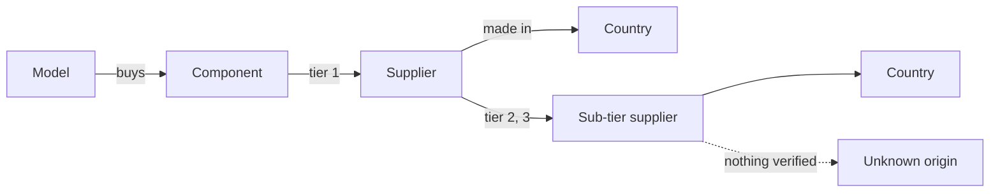

# Risk model

How a supplier claim is stored, and how the risk engine (`src/risk.js`) turns claims into verdicts.

## The data model



| Term | Meaning | Example |
|---|---|---|
| **Model** | A drone the procurement officer is assessing | Skydio X10 |
| **Component** | What the drone maker buys at tier 1 | motors, battery cells, flight controller chip, camera sensor, radio |
| **Tier** | How far down the chain a supplier sits. Tier 1 sells to the drone maker | Magnets are tier 2 of `motors`; rare-earth material is tier 3 |
| **Part** | Optional label for a sub-tier record | `"Magnets"`, `"Cathode material"` |
| **Link** | One sourced claim: this supplier, in this country, at this tier | Nidec Corporation, JP, tier 1 of Skydio X10 motors |
| **Unmapped** | A tier that was searched and nothing verifiable was found | Skydio X10 motors, tier 2 (magnets) |
| **Not researched** | No record at all for a component. The interface shows it grey, like unmapped | — |

Sub-parts are always deeper tiers of the component they sit in, never components of their own. A "domestic" motor with foreign magnets must show the foreign dependency in the motors chain, which is the whole point of the tool.

## The record format (`data/links.json`, frozen)

One flat array. Each record:

```json
{ "model": "", "component": "", "supplier": "", "supplier_country": "",
  "tier": 1, "source_url": "", "confidence": "high|low|unmapped",
  "conflict": false, "part": "optional" }
```

- **Append-only.** A link's `id` is its position in the array, and the query agent cites ids, so records are never reordered or removed. New batches go on the end.
- **An `unmapped` record for every tier searched without a verified result**, with empty `supplier`, `supplier_country` and `source_url`. That separates "searched, nothing found" from "never researched".
- **Countries** are ISO 3166 two-letter codes. A mapped link's country is where the part is made if a source says so, otherwise the supplier's headquarters (capped at `low`).
- **`conflict: true`** goes only on mapped records, on every side of a disagreement.

Role 1's full conventions: [links-format.md](links-format.md).

### Validation

Every record is checked each time the file is read. If any record is malformed (wrong field type, `tier` below 1, unknown `confidence`, or a mapped link with no supplier or no http(s) `source_url`), **the whole file is rejected** and the API returns 500 naming each bad record:

```
links.json rejected: record 2 (Falcon X / battery cells): tier must be a whole number from 1; record 5 (Hawk 2 / motors): confidence must be one of high, low, unmapped
```

Skipping a bad record instead could make a component look safe just because its evidence disappeared. The file is re-read on every request, so a fixed batch shows up without a restart.

## The rules

Every rule reads a component's **deepest mapped tier** and ignores `unmapped` records, except where it says otherwise.

| Rule | A component is flagged when | Why |
|---|---|---|
| **Single-country** | Every link at the deepest mapped tier names the same country. A link with a blank country blocks the claim | The headline risk: one export control stops the part |
| **Single-source** | Exactly one distinct supplier at the deepest mapped tier. Names match ignoring case and surrounding spaces | One company failing stops the part |
| **Unknown** | It has only `unmapped` records, or an `unmapped` record at a tier deeper than its deepest mapped tier | A gap must never read as safe |
| **Conflict** | Any of its mapped records has `conflict: true` | Sources disagree, so both are shown |
| **Low confidence** | Its deepest-tier evidence is all `low` (counted only for flagged components) | The verdict rests on weak sources |
| **Chokepoint** | A supplier appears in 2 or more models, at any tier | One supplier's failure hits several drones |

Single-country evidence that is only `low` confidence is still flagged, marked `low_confidence: true`: weak evidence of a risk is shown, not hidden.

### Cut-off simulation

`simulate_cutoff(country)` sorts every component of every model into:

| List | Meaning |
|---|---|
| `affected` | At least one mapped link is in that country |
| `fully_blocked` | The deepest mapped tier is only that country |
| `unknown` | Fully unmapped, or partly unmapped with no mapped link in that country: it might depend on that country |
| *(not listed)* | Fully mapped, with no link in that country |

A component is only left out when every tier is mapped and none is in that country. Anything with a gap stays in `unknown`.

## Worked example: Skydio X10 motors

The records (ids 11 to 14):

| id | Tier | Part | Supplier | Country | Confidence |
|---|---|---|---|---|---|
| 11 | 1 | | Nidec Corporation | JP | low |
| 12 | 1 | | Nidec Corporation | JP | low |
| 13 | 2 | Magnets | | | unmapped |
| 14 | 3 | Rare-earth material | | | unmapped |

1. The deepest mapped tier is 1. Both links there name JP, so the component is **single-country (Japan)**.
2. Both name one supplier, Nidec, so it is **single-source**.
3. Tiers 2 and 3 are unmapped and deeper than tier 1, so it is also **unknown**: the magnets could come from anywhere.
4. All deepest-tier evidence is `low`, so it is **low confidence**.
5. In a China cut-off, no mapped link is in China, but tier 2 is unmapped, so motors go in `unknown`, not "unaffected". In a Japan cut-off, they are `affected` and `fully_blocked`.

The API's `link_ids` for this component are `[11, 12, 13, 14]`: the evidence for the verdict, including the gaps, so the query agent can cite "unmapped" as a fact.
